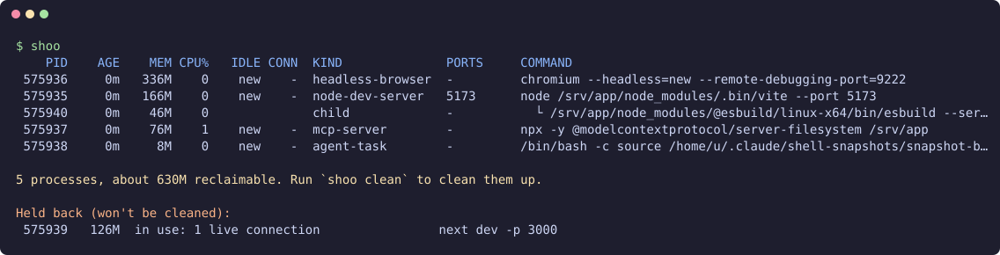

# shoo

Find and clean up **orphaned agent and dev-tool processes** that are quietly eating your RAM.

If you run coding agents on a Linux box (or a VPS), you've probably seen it: MCP servers, headless
browsers, dev servers, language servers and background shell tasks that an agent spawned, then
abandoned. Nothing is using them, nothing will ever use them again, and they hold hundreds of
megabytes each.

`shoo` finds those and, when you say so, terminates them. It is a **janitor, not a sniper**: it
only touches processes it can show are abandoned *and* idle, and it changes nothing unless you ask.



<sub>Demo run against simulated leftovers.</sub>

## "Zombie" processes vs. what you actually have

A true zombie (`Z` in `ps`) has already exited. It uses **no memory and no CPU**; it's just a leftover
entry waiting for its parent to collect it. You can't kill one, and it goes away when the parent does.

What eats your RAM is **orphaned live processes**: still running, but their parent (the agent session,
the shell, the terminal) is gone. That is what `shoo` looks for. (If zombies exist, `shoo` mentions
them and explains why there is nothing to kill.)

## Install

Requires Linux and Python 3.11+. No dependencies.

```bash
pipx install git+https://github.com/avtomate/shoo     # or, from a checkout: pipx install .
```

Or run straight from a checkout without installing: `PYTHONPATH=src python3 -m shoo`.

## Use

```bash
shoo                    # what's lying around (same as `shoo scan`; changes nothing)
shoo scan --why         # ...plus everything it skipped, and why
shoo clean              # clean it up (asks first)
shoo clean --dry-run    # show and record what would be cleaned, kill nothing
shoo log                # what was cleaned (or would have been)
shoo rules              # what it looks for
```

The columns:

| Column | Meaning |
| --- | --- |
| `MEM` | Proportional memory (PSS): shared pages are split between the processes sharing them, so the total is what you'd actually get back. Plain RSS would count Chrome's shared memory a dozen times. |
| `CPU%` | Over a short sample (`--sample SECS`, default 2). |
| `IDLE` | How long shoo has seen the whole tree sit idle across runs; `new` the first time it sees one. |
| `CONN` | Live TCP connections from *outside* the tree: someone is using it. |
| `PORTS` | Ports it's listening on, so you can sanity-check. |

Options for `scan` and `clean`: `--min-age 2h` (default `1h`), `--require-idle 2h`,
`--include-active`, `--protect REGEX` (repeatable), `--sample SECS`, `--config PATH`.

## Run it automatically

```bash
shoo schedule enable --dry-run    # watch first: records what it would clean, kills nothing
shoo log                          # ...a few days later, review
shoo schedule enable              # go live
shoo schedule status
shoo schedule disable
```

This installs a systemd *user* timer (no root, nothing system-wide) that runs hourly. Since nobody
is watching, the unattended defaults are cautious: only processes older than **6h** whose whole
tree has sat **idle for 2h** across runs (`--min-age`, `--require-idle` and `--every` to change).
On a server, make sure lingering is on (`loginctl enable-linger`) or the timer stops when you log
out; `schedule enable` warns if it's off.

## What gets cleaned

A process is a **candidate** only if **all** of these are true:

1. It matches a known agent or dev-tool rule (`shoo rules`): MCP servers, headless browsers,
   Playwright drivers, JS and Python dev servers, language servers, agent CLIs, background tasks
   from finished Claude Code sessions, `tail -f`-style watchers. Matching looks at the program and
   its first few arguments, never at directory names, so a project called `my-mcp` doesn't make
   everything inside it look like an MCP server.
2. It is **orphaned**: its parent is gone (re-parented to init or your `systemd --user`) and it is not
   attached to a live terminal. A process launched through a shell wrapper (`bash -c "npm run dev"`)
   counts as orphaned if the wrapper is.
3. It has been running longer than `--min-age`.
4. It is **yours**, and not a systemd service, Docker/Kubernetes container, or `tmux`/`screen`/`sshd`.

Children of a candidate go with it. A candidate tree is then **held back** (listed, not cleaned) if:

- anything outside the tree has a live connection to it (a browser tab, an SSH tunnel), unless
  `--include-active`, or
- `--require-idle` is set and shoo hasn't watched the tree stay under 1% CPU for that long. The
  whole tree's CPU is counted, including children that already exited, so a loop that keeps
  spawning short-lived commands isn't mistaken for idle.

`shoo` never targets itself or its own ancestors. To protect something:

```toml
# ~/.config/shoo/config.toml
min_age = "2h"
protect = ["my-staging-app", "--port 8080"]   # regexes against the command line
```

## Safety and privacy

- **Read-only by default.** `scan` changes nothing; `clean` asks for confirmation, and refuses to
  run without a terminal unless you pass `--yes`. `--dry-run` never signals anything.
- **No PID-reuse accidents.** Before every signal it re-checks the process's start time, so a recycled
  PID is never hit.
- **Graceful first.** SIGTERM, a grace period, then SIGKILL only for what's left.
- **Never reads environment variables** (`/proc/<pid>/environ`), where secrets live. It reads only the
  command line, which is shown and logged with obvious credentials (`--token ...`, `KEY=...`,
  `user:pass@`, `sk-...`) redacted.
- **Local only.** No network access, no telemetry, and it only ever acts on your own user's
  processes. Its state (idle history, log) lives in `~/.local/state/shoo`, readable only by you.

## Adding a rule

Rules live in `src/shoo/rules.py`. A rule is a regex over the program and its first few arguments.
Add a test case in `tests/test_rules.py` for both what it should match and a lookalike it must not.
`shoo scan --why` is the quickest way to find leftovers that no rule catches yet.

```bash
PYTHONPATH=src:tests python3 -m unittest discover -s tests
```

## Status

Early (0.1). Linux only.

## License

MIT
